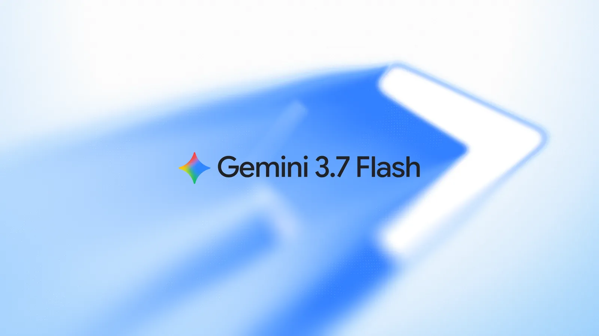
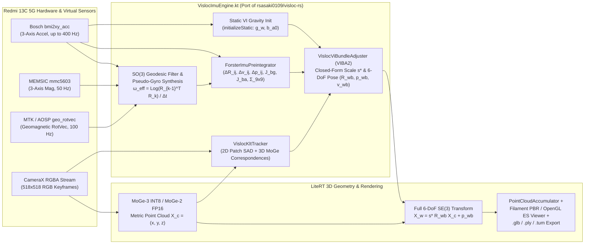
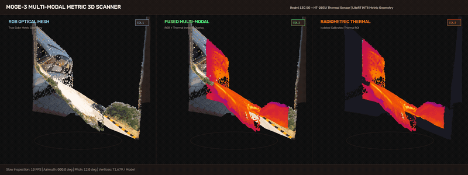

# VisLoc-MoGe-3DScanner — Visual-Inertial 6-DoF Metric 3D & Thermal Scanner for Android (Redmi 13C 5G Edition)

<table align="center" width="100%">
  <tr>
    <td width="33.33%" align="center" valign="middle">
      <a href="https://blog.google/technology/google-deepmind/gemini-model-updates-february-2025/">
        
      </a>
    </td>
    <td width="33.33%" align="center" valign="middle">
      <a href="https://antigravity.google/press">
        
      </a>
    </td>
    <td width="33.33%" align="center" valign="middle">
      <a href="https://developer.android.com/blog/posts/android-cli-build-android-apps-3x-faster-using-any-agent">
        
      </a>
    </td>
  </tr>
</table>

**VisLoc-MoGe-3DScanner** is a self-contained Android application uniting the **Visual-Inertial Localization & Forster On-Manifold IMU Pre-Integration** architecture of [**`rsasaki0109/visloc-rs`**](https://github.com/rsasaki0109/visloc-rs) with **on-device MoGe-3 / MoGe-2 LiteRT monocular metric 3D geometry**, **2D/3D KLT optical flow correspondence**, and **radiometric USB-C thermal camera fusion**.

Specifically engineered and hardware-verified for smartphones both **with** a 6-axis MEMS IMU and **without** a physical gyroscope—including the **Xiaomi Redmi 13C 5G (`23124RN87I`, MediaTek Dimensity 6100+)**, where continuous $SO(3)$ angular velocity $\boldsymbol{\omega}_{\text{eff}}(t)$ and gravity-compensated linear acceleration are synthesized from the hardware **Bosch `bmi2xy_acc` 3-axis accelerometer (400 Hz)**, **MEMSIC `mmc5603` 3-axis magnetometer (50 Hz)**, **AOSP/MTK `TYPE_GEOMAGNETIC_ROTATION_VECTOR` (100 Hz)**, and **2D/3D KLT visual correspondence**.

---

## 📥 Pre-Built APK Downloads & GitHub Releases

Direct download links for official release binaries on [**GitHub Releases (`1kaiser/visloc-moge-3dscanner/releases`)**](https://github.com/1kaiser/visloc-moge-3dscanner/releases):

* **[VisLoc-MoGe-3DScanner v1.0.0 (Latest Release)](https://github.com/1kaiser/visloc-moge-3dscanner/releases/tag/v1.0.0)**
  * **Full Metric APK**: [**`visloc-moge-3dscanner-v1.0.0.apk`**](https://github.com/1kaiser/visloc-moge-3dscanner/releases/download/v1.0.0/visloc-moge-3dscanner-v1.0.0.apk) — Self-contained offline build bundling both **MoGe-3 INT8** and **MoGe-2 FP16** LiteRT models, **`VislocImuEngine`** (Forster on-manifold IMU pre-integrator + KLT tracker + VIBA2 scale/pose solver), **Google Filament 1.71.5** native PBR 3D viewer, and **HT-203U / InfiRay** USB-C thermal fusion.

---

## 🧭 `visloc-rs` Visual-Inertial Architecture & Redmi 13C 5G Hybrid IMU Fusion

### 1. Hardware Sensor Reality on Xiaomi Redmi 13C 5G (`23124RN87I`)
A live `dumpsys sensorservice` audit of the Redmi 13C 5G reveals the following physical and virtual sensor stack:

| Sensor Handle | Hardware / Driver Name | Vendor | Android Sensor Type | Max Rate | Role in `VislocSensorEngine` |
| :--- | :--- | :--- | :--- | :--- | :--- |
| `0x01000001` | `bmi2xy_acc` | Bosch | `TYPE_ACCELEROMETER (1)` | **400 Hz** | Specific force $\tilde{\mathbf{a}}_k$, static gravity initialization (`initializeStatic`), Forster $\Delta \mathbf{v}_{ij}, \Delta \mathbf{p}_{ij}$ pre-integration |
| `0x01000002` | `mmc5603` | MEMSIC | `TYPE_MAGNETIC_FIELD (2)` | **50 Hz** | Heading reference & geomagnetic attitude stabilization |
| `0x01000014` | `geo_rotvec` | MTK / AOSP | `TYPE_GEOMAGNETIC_ROTATION_VECTOR (20)` | **100 Hz** | Drift-free 3D orientation $\mathbf{R}_{wb}(t) \in SO(3)$ & pseudo-gyro $\boldsymbol{\omega}_{\text{eff}}(t)$ synthesis |
| `0x01000009` | `gravity` | MTK | `TYPE_GRAVITY (9)` | **100 Hz** | Gravity direction $\mathbf{g}_b$ isolation in body frame |
| `0x0100000a` | `linear_acc` | MTK | `TYPE_LINEAR_ACCELERATION (10)` | **100 Hz** | Gravity-compensated linear acceleration cross-check |
| — | *No Physical MEMS Gyro* | — | `TYPE_GYROSCOPE (4)` = `null` | — | Automatically replaced by $SO(3)$ logarithmic rate $\boldsymbol{\omega}_{\text{eff}} = \frac{1}{\Delta t}\text{Log}(\mathbf{R}_{k-1}^\top \mathbf{R}_k)$ + KLT optical flow |

### 2. End-to-End Visual-Inertial 3D Reconstruction Pipeline



### 3. Mathematical Formulation (`VislocImuEngine.kt`)

#### A. $SO(3)$ Lie Group Exponential, Logarithm & Right Jacobian
Matching `imu_preintegration.rs` in `visloc-rs`, rotations are parameterized on the $SO(3)$ manifold via Rodrigues' formula:
$$\text{Exp}(\boldsymbol{\phi}) = \mathbf{I}_3 + \frac{\sin\theta}{\theta}[\boldsymbol{\phi}]_\times + \frac{1 - \cos\theta}{\theta^2}[\boldsymbol{\phi}]_\times^2, \qquad \theta = \|\boldsymbol{\phi}\|_2$$
$$\mathbf{J}_r(\boldsymbol{\phi}) = \mathbf{I}_3 - \frac{1 - \cos\theta}{\theta^2}[\boldsymbol{\phi}]_\times + \frac{\theta - \sin\theta}{\theta^3}[\boldsymbol{\phi}]_\times^2$$
When a physical gyroscope is absent (`hasHardwareGyro == false`), body-frame angular velocity $\boldsymbol{\omega}_{\text{eff}}(t_k)$ is synthesized from consecutive geodesic-smoothed attitude matrices:
$$\boldsymbol{\omega}_{\text{eff}}(t_k) = \frac{1}{\Delta t_k}\text{Log}\!\left(\mathbf{R}_{wb}(t_{k-1})^\top \mathbf{R}_{wb}(t_k)\right)$$

#### B. Forster On-Manifold IMU Pre-Integration (Forster et al., IEEE T-RO 2017)
Between keyframes $i$ and $j$, `ForsterImuPreintegrator` accumulates gravity-compensated linear acceleration $\hat{\mathbf{a}}_k = \tilde{\mathbf{a}}_k - \mathbf{g}_b - \mathbf{b}_a$ and angular rate $\hat{\boldsymbol{\omega}}_k = \boldsymbol{\omega}_{\text{eff},k} - \mathbf{b}_g$ in keyframe $i$'s reference frame without re-integrating when biases change:
$$\Delta \mathbf{p}_{ik+1} = \Delta \mathbf{p}_{ik} + \Delta \mathbf{v}_{ik}\Delta t + \frac{1}{2}\Delta \mathbf{R}_{ik}\hat{\mathbf{a}}_k \Delta t^2$$
$$\Delta \mathbf{v}_{ik+1} = \Delta \mathbf{v}_{ik} + \Delta \mathbf{R}_{ik}\hat{\mathbf{a}}_k \Delta t$$
$$\Delta \mathbf{R}_{ik+1} = \Delta \mathbf{R}_{ik}\,\text{Exp}(\hat{\boldsymbol{\omega}}_k \Delta t)$$
First-order bias Jacobians $\left(\frac{\partial \Delta \mathbf{R}_{ij}}{\partial \mathbf{b}_g}, \frac{\partial \Delta \mathbf{v}_{ij}}{\partial \mathbf{b}_g}, \frac{\partial \Delta \mathbf{v}_{ij}}{\partial \mathbf{b}_a}, \frac{\partial \Delta \mathbf{p}_{ij}}{\partial \mathbf{b}_g}, \frac{\partial \Delta \mathbf{p}_{ij}}{\partial \mathbf{b}_a}\right)$ are propagated at every sample so `ImuPreintegratedDelta.corrected(newBg, newBa)` applies first-order updates in $O(1)$ time.

#### C. VIBA2 Closed-Form Scale & 6-DoF Keyframe Pose Alignment
Between consecutive keyframes $i \to j$, `VislocKltTracker` tracks textured $9\times 9$ luminance patches across downsampled $518\times 518$ frames and lifts inlier matches using their 3D MoGe metric coordinates to estimate the camera-frame translation $\Delta \mathbf{t}_{\text{vis}}$ via trimmed median outlier rejection. `VislocViBundleAdjuster` then updates the metric alignment scale $s^*$ in closed form (`estimate_scale_from_factors` in `visloc-rs`):
$$s^* = \text{clip}\!\left(\frac{\sum_{k} \mathbf{d}_{\text{imu},k}^\top \mathbf{d}_{\text{vis},k}}{\sum_{k} \|\mathbf{d}_{\text{vis},k}\|_2^2},\; s_{\min},\; s_{\max}\right)$$
and transforms every incoming MoGe 3D point $\mathbf{x}_c \in \mathbb{R}^3$ into the unified gravity-leveled world frame via full $SE(3)$ rigid-body transformation:
$$\mathbf{x}_w = s^* \mathbf{R}_{wb_j} \mathbf{x}_c + \mathbf{p}_{wb_j}$$
*(Whereas the original `MoGe3DScanner` applied rotation-only $\mathbf{R}_{\text{rel}}\mathbf{x}_c$ with zero translation and relied solely on `TYPE_ROTATION_VECTOR`.)*

---

## 🎬 Multi-Modal 3D Model Demonstration

<p align="center">
  
</p>

| Column 1: Optical RGB | Column 2: Fused Multi-Modal | Column 3: Radiometric Thermal |
| :--- | :--- | :--- |
| **Model:** `moge_scan_<ts>_rgb.glb` | **Model:** `moge_scan_<ts>_fused.glb` | **Model:** `moge_scan_<ts>_thermal.glb` |
| True-color optical camera RGB texture on metric 3D mesh. | Calibrated Ironbow radiometric heatmap registered over RGB scene context. | Isolated thermal false-color radiometry mapped to metric surface geometry. |

---

## 🌟 Key Features

1. **Real-Time `visloc-rs` VI-SLAM Telemetry HUD**:
   - Displays active sensor fusion mode (`Redmi 13C Hybrid (BMI2xy Acc + MMC5603 Mag + KLT)` or `6-Axis Hardware IMU + VIBA2`).
   - Live attitude Roll / Pitch / Yaw (degrees) and measured accelerometer frequency (Hz).
   - Live 6-DoF camera trajectory position $\mathbf{p}_{wb} = (x, y, z)$ in meters, VIBA2 scale factor $s$, keyframe counter (`KF`), and 2D/3D KLT inlier count.
   - Live Forster pre-integrated increments $\Delta \mathbf{p}_{ij}$, $\Delta \mathbf{v}_{ij}$, and estimated accelerometer bias norm $\|\mathbf{b}_a\|_2$.
2. **Full 6-DoF Multi-Frame 3D Point Cloud Accumulation (`✓ Multi 6-DoF`)**:
   - Merges multi-view MoGe-3 / MoGe-2 point clouds using full $SE(3)$ rotation + translation $(\mathbf{R}_{wb}, \mathbf{p}_{wb})$.
   - Automatically exports the 6-DoF camera trajectory (`visloc_trajectory_<timestamp>.tum`) in standard TUM RGB-D / EuRoC format (`timestamp tx ty tz qx qy qz qw`) to `/sdcard/Download/` alongside `.glb` and `.ply` 3D scans.
3. **On-Device Monocular Metric 3D Geometry (MoGe-3 INT8 & MoGe-2 FP16)**:
   - Hardware-accelerated LiteRT GPU / XNNPACK inference on Android.
4. **USB-C Thermal Radiometry & 4-Corner Perspective Homography**:
   - Connects to HT-203U / InfiRay UVC thermal cameras (`VID:0x2bdf PID:0x0102`), computes Celsius temperatures, and projects Ironbow thermal textures onto 3D geometry.
5. **Google Filament 1.71.5 Native PBR 3D Viewer**:
   - Zero-WebView, 120 FPS hardware-accelerated glTF/GLB turntable inspection directly inside the app.

---

## 🏗️ Repository Structure

| File | Description |
| :--- | :--- |
| `app/src/main/java/com/example/moge3dscanner/ui/main/VislocImuEngine.kt` | **Core `visloc-rs` Port**: `VislocMath` ($SO(3)$ `so3Exp`, `so3Log`, `rightJacobian`), `ForsterImuPreintegrator`, `VislocKltTracker` (2D/3D patch optical flow), `VislocViBundleAdjuster` (static gravity init, VIBA2 closed-form scale & 6-DoF pose fusion, TUM trajectory export), and `VislocSensorEngine` (Redmi 13C 5G hybrid accelerometer + magnetometer + geomagnetic rotation vector + pseudo-gyro synthesis) |
| `app/src/main/java/com/example/moge3dscanner/ui/main/MainScreen.kt` | Compose UI, live `visloc-rs` VI-SLAM HUD, CameraX analyzer, 6-DoF $SE(3)$ multi-frame point cloud transformer, OpenGL ES & Filament 3D viewers, GLB/PLY/TUM exporters |
| `app/src/main/java/com/example/moge3dscanner/ui/main/MogeInterpreter.kt` | LiteRT / TFLite engine supporting MoGe-3 ViT-L INT8 metric depth and MoGe-2 FP16 |
| `app/src/main/java/com/example/moge3dscanner/ui/main/Filament3DViewer.kt` | Native Google Filament 1.71.5 PBR GLB viewer |
| `app/src/main/java/com/example/moge3dscanner/ui/main/DatasetBatchProcessor.kt` | Offline dataset batch processor generating Fused, RGB, and Thermal 3D GLB models |
| `app/src/main/java/com/example/moge3dscanner/thermal/` | USB-C UVC bulk driver & radiometric Ironbow LUT for HT-203U / InfiRay thermal cameras |

---

## ⚙️ Build & Wireless ADB Installation (Redmi 13C 5G)

```bash
# 1. Download MoGe-3 LiteRT model (if cloning fresh repo without large binary assets)
./download_models.sh

# 2. Build the Debug APK
./gradlew assembleDebug

# 3. Pair & Connect over Wi-Fi ADB to Redmi 13C 5G
adb pair <PHONE_IP>:<PAIRING_PORT> <PAIRING_CODE>
adb connect <PHONE_IP>:<CONNECT_PORT>

# 4. Install & Launch VisLoc-MoGe-3DScanner
adb -s <PHONE_IP>:<CONNECT_PORT> install -r -t -g app/build/outputs/apk/debug/app-debug.apk
adb -s <PHONE_IP>:<CONNECT_PORT> shell am start -n com.example.vislocmoge3dscanner/com.example.moge3dscanner.MainActivity
```

---

## 📚 References & Acknowledgments

* **`visloc-rs` — Visual Localization & Visual-Inertial SLAM in Rust**:
  * R. Sasaki, *visloc-rs: Feature matching, PnP localization, and monocular visual-inertial odometry in Rust*, [https://github.com/rsasaki0109/visloc-rs](https://github.com/rsasaki0109/visloc-rs)
* **On-Manifold IMU Pre-Integration**:
  * C. Forster, L. Carlone, F. Dellaert, and D. Scaramuzza, *"On-Manifold Preintegration for Real-Time Visual-Inertial Odometry,"* IEEE Transactions on Robotics (T-RO), vol. 33, no. 1, pp. 1–21, 2017.
* **MoGe — Monocular Geometry Estimation**:
  * R. Wang et al., *"MoGe: Unlocking Accurate Monocular Geometry Estimation for Open-Domain Images with Optimal Training Supervision,"* CVPR 2025, [https://github.com/microsoft/MoGe](https://github.com/microsoft/MoGe)
